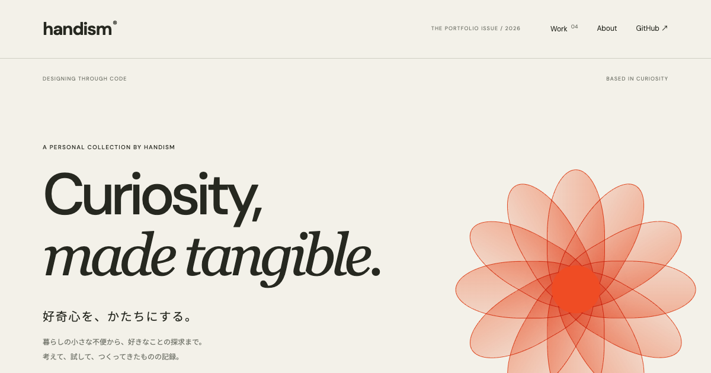

# handism.github.io

handism のポートフォリオサイトです。公開中のリポジトリを紹介しています。

**https://handism.github.io/**



- 作品のカテゴリー絞り込みと詳細表示（公開デモ・最新リリースへのリンク付き）
- アニメーションは右下のボタンで停止でき、端末のモーション低減設定にも従います
- キーボード操作・スマートフォン幅に対応

作品ビジュアルはCSSで描いたイラストです（実際のアプリ画面ではありません）。

## 開発

Astro / TypeScript / Playwright。Node.js 22.12 以上が必要です。

```sh
npm ci
npm run dev            # http://127.0.0.1:4321/
npm run check          # 型チェック
npm run test:browser   # ブラウザテスト
```

`main` への push で GitHub Actions がチェックとテストを実行し、GitHub Pages へデプロイします。
